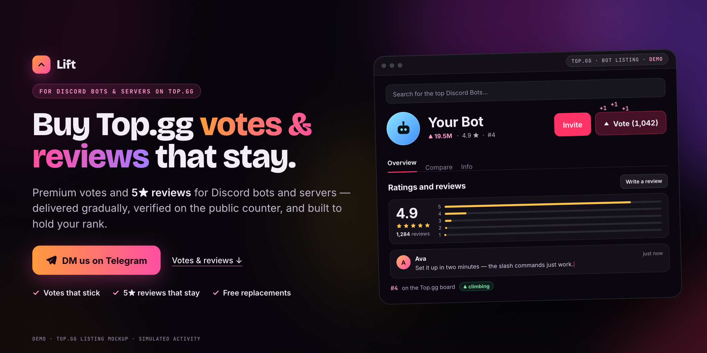
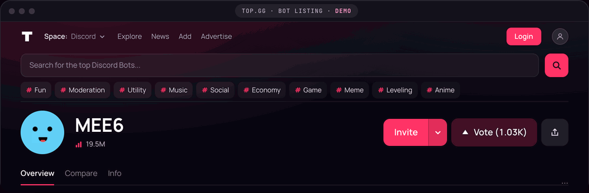
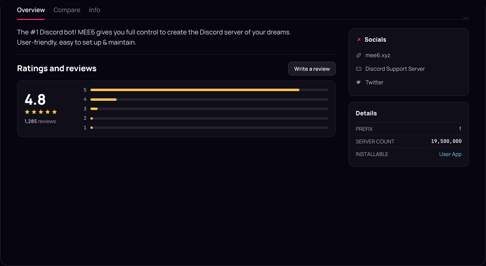
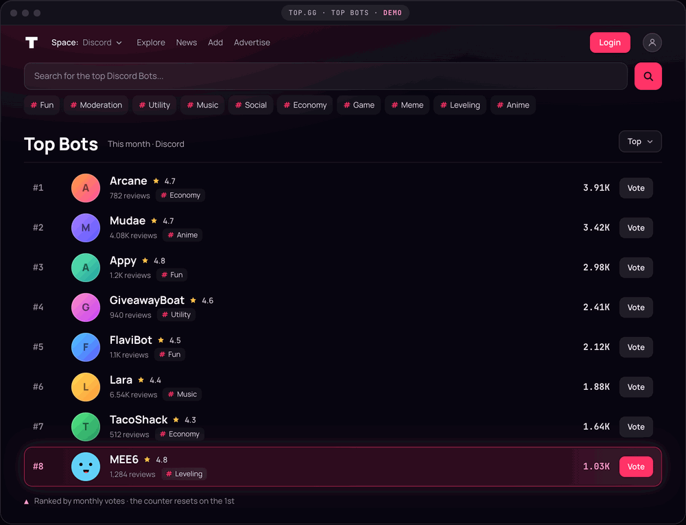

  

<h1 align="center">Buy Top.gg Votes &amp; Reviews for Discord Bots &amp; Servers</h1>

  <b>Votes that stick. Reviews that stay. A rank that holds.</b> 
  Delivered gradually, verified on the public counter, replaced free if anything drops.

  

  <a href="#topgg-votes">Votes</a> &nbsp;·&nbsp; <a href="#topgg-reviews">Reviews</a> &nbsp;·&nbsp; <a href="#topgg-ranking">Ranking</a> &nbsp;·&nbsp; <a href="#how-it-works">How it works</a> &nbsp;·&nbsp; <a href="#faq">FAQ</a>

**Lift sells Top.gg votes and reviews for Discord bots and servers.** Votes arrive gradually
from. Reviews are written for your bot and posted over days. No token, no login, just
the listing link.

## Top.gg votes

Top.gg gives every account one vote every 12 hours and resets every counter on the 1st. We turn
that clock into steady delivery: votes land across the month, weighted to the weekend when they
count twice, instead of a spike that gets purged overnight.

- Aged accounts, real browsers, mobile and residential IPs
- Every vote checked on the public counter
- Dropped or discounted votes replaced free

 

## Top.gg reviews

Reviews turn a visitor into a vote. Each one is written for your bot's real features, in a
different voice and length, and posted across several days — never a wall of identical text.

- Mostly 5★ with honest 4★ mixed in
- They stay on your listing and do not reset on the 1st
- Deleted within 7 days? Replaced once, free

 

## Top.gg ranking

Rank is a monthly race: counters reset on the 1st, weekends count double, and the first weeks
decide the month. We start at day one, track where you began and where you finished, and can keep
a monthly drip running so the position holds.

- Day-one starts, weekend-weighted
- Before and after rank report
- Optional monthly drip to hold position

 

## How it works

1. **Send your listing.** DM the bot or server's Top.gg link on Telegram.
2. **Get a plan.** We reply with the quantity and the days it will land.
3. **Watch it land.** Delivery starts after confirmation; you get a report at the end.

## FAQ

<b>What exactly am I buying?</b>

 
Top.gg votes, reviews, or both for one Discord bot or server listing. Votes are delivered
gradually and checked against the public counter; reviews are written for your bot and posted over
several days. You approve the quantity and schedule before anything starts.

<b>Are these real votes that stay?</b>

 
Yes. We deliver gradually from aged Discord accounts on clean IPs — not a burst. Every vote is
checked on the public counter, and any vote Top.gg drops or discounts is re-delivered free.

<b>Do you need my bot token or Discord login?</b>

 
No. Your public Top.gg listing link is all we need. No bot access, no server permissions, no login.

<b>How fast will the votes land?</b>

 
Gradual by design. Your plan includes the exact schedule; small orders usually finish in days, and
larger orders are spaced out further. We never compress a delivery into a spike.

<b>Do reviews reset on the 1st like votes?</b>

 
No. Votes reset monthly on Top.gg; reviews do not. A published review stays on your listing until
you ask us to remove it — and if it disappears within 7 days, we replace it once.

  <h2>Ready to lift your listing?</h2>
  
Send your Top.gg link on Telegram. We reply with a plan and a start date.

  

Independent service. Not affiliated with Top.gg or Discord. Demos are mockups; counters, reviews and ranks are simulated. MEE6 appears as a public mockup, not a client.

Top.gg votes · topgg votes · buy Top.gg votes · Top.gg reviews · top gg reviews · Discord bot votes · Discord server votes · Top.gg ranking boost
